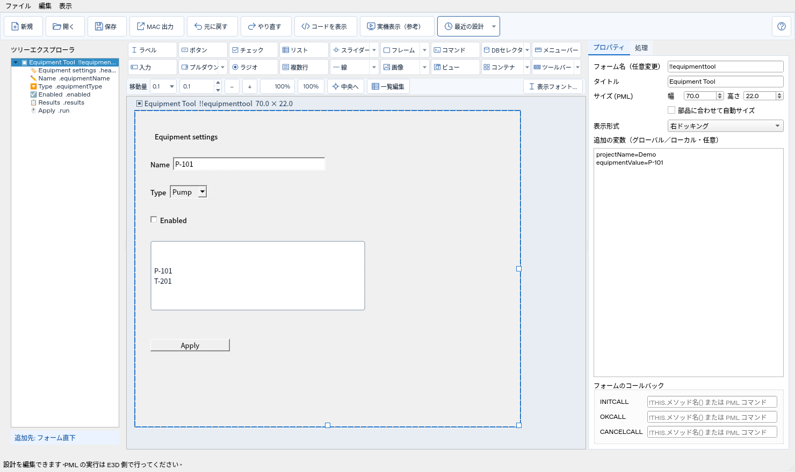
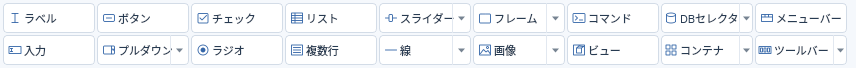
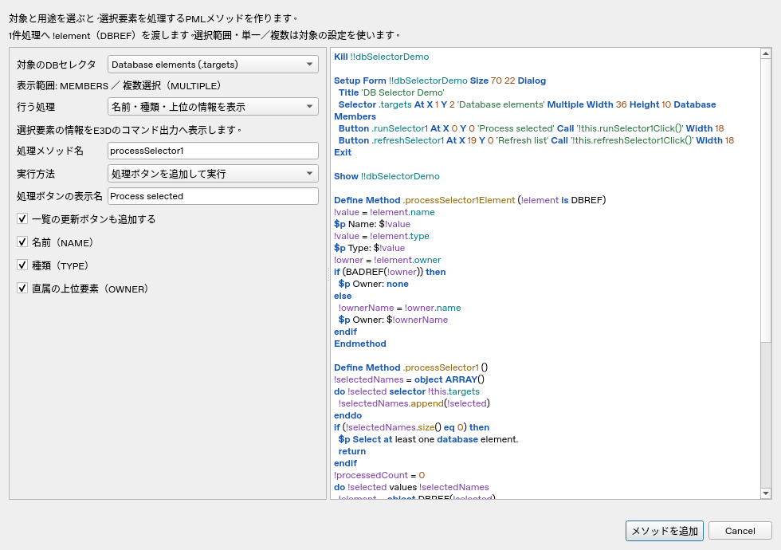
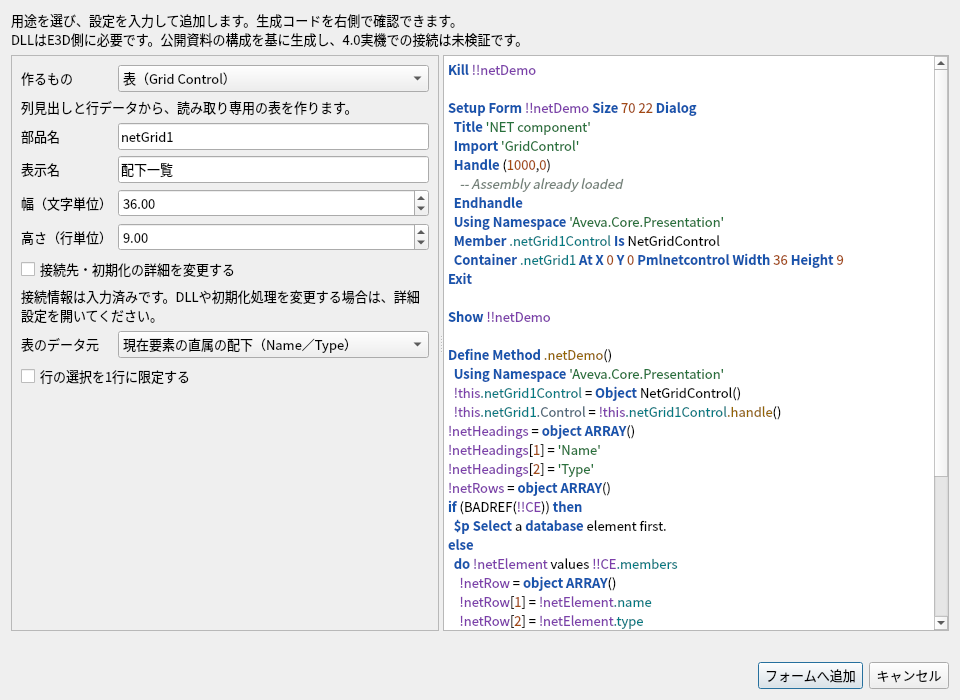
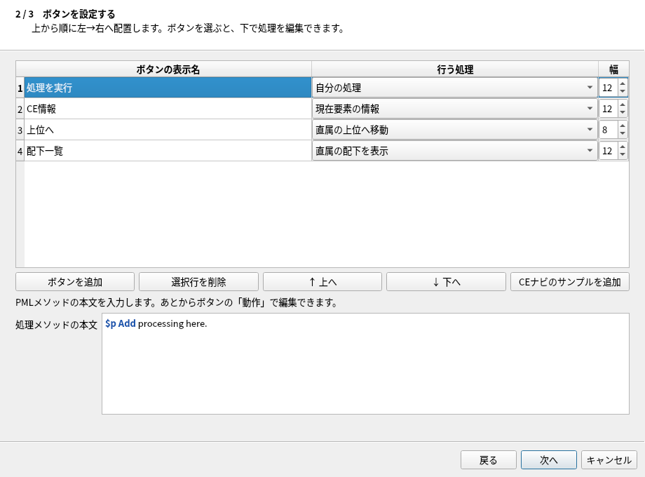

# FormDesigner 詳細操作マニュアル

更新日: 2026年10月11日（日本時間）

AVEVA E3D向けのPMLフォームを、画面上で設計するためのマニュアルです。
18ボタン・9列×2行の部品パレットと、ツールバー・コンテナ・DBセレクタの簡単作成に対応しています。

このアプリは設計・コード生成・保存を行います。E3DやDLLを実行する環境ではありません。
E3D 4.0を想定していますが、実機の表示・構文・文字コード・接続は未確認です。
以下の説明では、アプリ内で確認できる操作と、E3D側で行う作業を分けて記載します。

ブラウザー版は [docs/manual/index.html](docs/manual/index.html)、印刷用は [PDF](docs/manual/FormDesigner-Manual.pdf) です。
ZIPを展開した後、HTMLをブラウザーで開くと目次から移動できます。文書内検索はCtrl+Fを使います。
アプリからは「新規・開く」などがある上部操作列の右端の？、またはF1で開けます。

## 目次

1. [最初に知っておくこと](#overview)
2. [起動とファイル構成](#start)
3. [画面の見方と18ボタンの並び](#screen)
4. [最初のフォームを作る](#first-form)
5. [23種類の部品一覧](#gadgets)
6. [配置・サイズ・フレーム・タブ](#layout)
7. [文字・入力・選択部品の設定](#input)
8. [ボタン・メソッド・外部マクロ](#actions)
9. [リスト・Excel・複数列の表](#lists)
10. [DBセレクタの基本と簡単メソッド作成](#selector)
11. [コンテナと.NET部品の簡単作成](#container)
12. [ツールバーの簡単作成とCEナビ](#toolbar)
13. [メニューバー・画像・ビュー](#menus-images)
14. [変数・DEFAULT・補助メソッド](#methods)
15. [コピー・名前変更・一括編集](#reuse)
16. [既存MACの取り込みと元コードの保持](#import)
17. [保存・MAC出力・E3Dでの利用](#output)
18. [プレビュー・復元・困ったとき](#trouble)
19. [ショートカット・用語・制約](#reference)
20. [用途別サンプルと公式資料](#examples)

<a id="overview"></a>
## 1. 最初に知っておくこと

### 1.1 このアプリでできること

- PMLフォームの部品を追加し、位置・大きさ・表示文字・初期値を設定する。
- フレーム・タブ・メニューバーを組み合わせ、画面の構造を設計する。
- ボタンのメソッド、外部マクロの呼び出し、DBセレクタの処理を作成する。
- CONTAINERとPML.NET部品の宣言・接続・初期化コードを生成する。
- JSONで設計を保存し、E3D用のMACを出力する。
- 対応する既存MACを取り込み、画面・処理を継続編集する。

### 1.2 JSON・MAC・外部ファイルの違い

| ファイル | 用途 | 通常の使い方 |
| --- | --- | --- |
| 設計JSON | 部品・配置・初期値・処理などを保存 | 継続編集のために「保存」で作成する |
| 出力MAC | E3Dへ渡すPMLフォームのコード | 「MAC 出力」で作成する |
| 外部MAC | ボタンから呼び出す別の処理 | E3Dから読める場所へ配置し、ボタンにパスを設定する |
| 画像 | ラベルや画像選択欄の表示素材 | JSONやMACと一緒に配布するか、共有パスを指定する |
| .NET DLL | CONTAINERへ接続する画面部品 | E3D側で読込・使用できる状態にする |
| settings.json | 出力先・最近の設計などのアプリ設定 | アプリが管理する。設計JSONとは別のファイル |

MACを出力しても、画像・DLL・外部マクロをMACの中へ埋め込むことはありません。
設計の再編集にはJSONを残してください。

### 1.3 E3D側で必要な作業

生成したPMLの構文・フォント・表示寸法を実機で確認します。
外部マクロのパス、DLLの名前・公開API、MAINフォームの登録方法は使用するE3D環境に合わせます。
標準TOOLBARはメニューバーを持つモジュール用で、リボンへの登録機能は含みません。

<a id="start"></a>
## 2. 起動とファイル構成

### 2.1 WindowsのPython版

Python 3.12をインストールし、ZIPを展開します。
`run_designer.py` と `requirements.txt` のあるフォルダーをPowerShellで開きます。

```powershell
py -3.12 -m venv .venv
.\.venv\Scripts\python.exe -m pip install -r requirements.txt
.\.venv\Scripts\python.exe -m e3d_designer
```

依存パッケージはPySide6 6.10.2とopenpyxl 3.1.5です。
一度インストールした後は、最後の起動コマンドを実行します。

### 2.2 WindowsのEXE版

既にビルド済みなら `FormDesigner.exe` を起動します。
onedir形式では、EXEのあるフォルダー全体が必要です。EXEだけを別の場所へ移動しないでください。

GitHubのソースZIPからEXEを作成する場合は、Windowsで次を実行します。

```powershell
powershell -NoProfile -ExecutionPolicy Bypass -File .\build_onedir.ps1
```

生成先は `dist/FormDesigner` です。マニュアル・サンプル・画像もコピーします。
詳しい手順は [EXE_BUILD_ONEDIR.txt](EXE_BUILD_ONEDIR.txt) にあります。
このクラウド環境ではWindows EXEのビルドを確認していません。

### 2.3 LinuxのPython版

```bash
python3 -m venv .venv
.venv/bin/python -m pip install -r requirements.txt
.venv/bin/python -m e3d_designer
```

画面操作にはデスクトップ環境が必要です。
検証用のoffscreen起動は、通常の画面操作とは異なります。

### 2.4 サンプルから試す

「開く」で [examples/equipmenttool.json](examples/equipmenttool.json) を選びます。
初めての場合は別名保存し、元のサンプルを残すと比較しやすくなります。
ツールバーなどを試すときは、[20章](#examples)の専用サンプルを使います。

<a id="screen"></a>
## 3. 画面の見方と18ボタンの並び



### 3.1 画面の領域

| 領域 | 役割 |
| --- | --- |
| 最上段のメニューバー | ファイル・編集・表示の操作 |
| その下の操作列 | 新規、開く、保存、MAC出力、Undo／Redo、コード表示など |
| 上部操作列の右端の？ | 詳細マニュアルを既定のブラウザーで開く |
| 左側のツリー | フォーム・フレーム・タブ・部品の階層を表示 |
| 中央上部の18ボタン | 部品追加と種類・簡単作成の選択 |
| 中央のキャンバス | 部品の選択、移動、サイズ変更、配置確認 |
| 右側のプロパティ | フォームまたは選択部品の設定 |
| 別ウィンドウのコード表示 | 生成コード、チェック結果、出力先、MAC出力 |

アプリの「ファイル／編集／表示」は通常のメニューバーです。
部品パレットの「メニューバー」は、設計するE3Dフォームへ追加するメニューの編集入口です。
この2つは役割が異なります。

### 3.2 ボタンの指定順



| 行 | 左から右への順番 |
| --- | --- |
| 1行目 | ラベル、ボタン、チェック、リスト、スライダー、フレーム、コマンド、DBセレクタ、メニューバー |
| 2行目 | 入力、プルダウン、ラジオ、複数行、線、画像、ビュー、コンテナ、ツールバー |

通常幅では9列×2行です。各ボタンは幅92px・高さ30px、行間と列間は2pxです。
中央の幅が狭い場合は、同じ順序を保って折り返します。
2行で表示したい場合はウィンドウを広げるか、左右の仕切りを動かして中央を広げます。

### 3.3 ボタン本体と▼の使い分け

ボタン本体は部品を追加します。種類をまとめたボタンでは、▼で選んだ種類を次のクリックでも追加します。
選択している種類はメニューのチェックとツールチップで確認できます。

| ボタン | ▼で選べる内容 |
| --- | --- |
| スライダー | 横スライダー、縦スライダー |
| フレーム | 通常フレーム、タブ |
| プルダウン | OPTION、COMBO |
| 線 | 横線、縦線 |
| 画像 | 画像ラベル、画像選択 |
| DBセレクタ | 部品の追加、メソッドの簡単作成 |
| コンテナ | 空の部品の追加、.NET部品の簡単作成 |
| ツールバー | 標準TOOLBARの手動追加、ツールバーの簡単作成 |

▼のあるボタンにフォーカスがあるときは、↓、Alt+↓、F4でもメニューを開けます。
簡単作成画面は「編集」メニューからも開けます。
キャンバス上部にはコード・プレビューのボタンを置かず、上部操作列やショートカットから開きます。

### 3.4 右端の？でマニュアルを開く


？は上部操作列の右端に固定しています。ウィンドウを広げても右端に表示します。
クリックするかF1を押すと、同梱のブラウザー版マニュアルを開きます。インターネット接続は不要です。
目次で章を選び、目次検索やCtrl+Fで必要な説明を探せます。
この操作は設計JSON・生成MAC・Undo履歴を変更しません。

HTMLが見つからない場合は、同梱のPDF版を開きます。
両方が見つからない場合は、`docs/manual` をアプリと同じフォルダーへ配置してください。
Python版・EXE版とも、配布フォルダー全体を保って使用します。
既定のブラウザーまたはPDFビューアーが開けない場合は、案内されたファイルを直接開き、OSの関連付けを確認してください。

<a id="first-form"></a>
## 4. 最初のフォームを作る

### 4.1 文字入力と実行ボタンの例

ここでは「設備名を入力し、実行ボタンでその文字を表示するフォーム」を設計します。

1. 「新規」を押します。未保存の設計がある場合は保存してから進みます。
2. フォーム枠またはツリーのフォームを選び、タイトルを「設備入力」にします。
3. 「入力」を押してTEXTを追加します。
4. TEXTの部品名を `equipmentName`、表示文字を「設備名」、入力型をSTRINGにします。
5. 初期値を `P-101` とし、幅と位置を調整します。
6. ツリーのフォームを選び、「ボタン」で実行ボタンを追加します。
7. ボタンの表示文字を「実行」にし、「動作」から処理コードを編集します。
8. 次の本文を入力します。DEFINE METHODとENDMETHODは入力しません。

```pml
!name = !this.equipmentName.val
if (!name eq '') then
  $p Enter an equipment name.
  return
endif
$p Equipment: $!name
```

9. 「保存」で `equipment-input.json` を作成します。
10. Ctrl+Shift+Cでコードを開き、チェック結果を確認します。
11. 「MAC 出力」で `equipment-input.mac` を作成します。

この処理を実行するのはE3Dです。アプリの参考表示でボタンを押してもPMLを実行しません。
完成した [編集用JSON](examples/manual/first-form.json) と [CP932のMAC](examples/manual/first-form.mac) を同梱しています。[サンプルの開き方](examples/manual/README.md) も参照してください。
TEXTを `equipmentName` 以外の名前にした場合は、本文の参照名も合わせてください。
アプリの名前変更機能を使うと、認識できるフォーム内参照も更新します。

### 4.2 名前は最初から入力されている

新規フォーム名・部品名・処理メソッド名は自動設定されます。
そのまま追加・保存・出力して構いません。用途に合わせて整理したいときだけ変更します。
通常の新規部品名は英字から始まる英数字とアンダースコアを使います。
同じフォーム内では部品・メソッド・変数などの名前が衝突しないようにします。

### 4.3 設定を変更する場所

フォームを選ぶと、タイトル・サイズ・表示形式・追加の変数などを設定できます。
部品を1つ選ぶと、その種類に必要な項目を右側へ表示します。
複数部品の選択中は個別プロパティを無効にします。1つだけ選び直すと編集できます。

<a id="gadgets"></a>
## 5. 23種類の部品一覧

見えているボタンは18個ですが、種類をまとめた選択肢を含めると23項目です。
簡単作成画面は補助機能で、23項目の部品数には加えません。

| No. | 種類 | 主なPML | 用途・基本入力 |
| --- | --- | --- | --- |
| 1 | ラベル | PARAGRAPH | 説明文・見出し。表示文字、幅、位置 |
| 2 | ボタン | BUTTON | 処理の実行。表示文字、メソッドまたはCALL |
| 3 | チェック | TOGGLE | 有効／無効の切り替え。表示文字、TRUE／FALSE |
| 4 | リスト | LIST | 単列一覧・複数列の表。項目、実値、選択方式 |
| 5 | 横スライダー | SLIDER HORIZONTAL | 数値調整。最小・最大・刻み・値 |
| 6 | 縦スライダー | SLIDER VERTICAL | 縦方向の数値調整。同じ範囲設定 |
| 7 | フレーム | FRAME | 部品のまとまり。表示文字、親、配置 |
| 8 | タブ | FRAME TABSET | ページ切り替え。タブページと中の部品 |
| 9 | コマンド | COMMANDLINE | コマンド用の表示領域。サイズ、追加PML |
| 10 | DBセレクタ | SELECTOR DATABASE | DB要素の選択。範囲、単一／複数、処理 |
| 11 | メニューバー | BAR／MENU | 見出しとメニュー項目。表示名、コマンド |
| 12 | 入力 | TEXT | 文字・数値入力。STRING／REAL、初期値、幅 |
| 13 | プルダウン | OPTION | 選択肢とコマンド、または表示名と実値 |
| 14 | コンボ | COMBO／COMBOBOX | 選択欄。表示名、実値、初期値、イベント |
| 15 | ラジオ | RTOGGLE | 同じフレーム内での択一選択 |
| 16 | 複数行 | TEXTPANE | 複数行の文字入力・表示。行内容、等幅設定 |
| 17 | 横線 | LINE HORIZ | 横の区切り。長さを設定 |
| 18 | 縦線 | LINE VERT | 縦の区切り。長さを設定 |
| 19 | 画像 | PARAGRAPH PIXMAP | 画像を表示。画像パス、位置 |
| 20 | 画像選択 | OPTION PIXMAP | 複数画像から選択。画像パスの一覧 |
| 21 | ビュー | VIEW | E3D用ビュー領域。種類、サイズ、追加PML |
| 22 | コンテナ | CONTAINER PMLNETCONTROL | .NET画面部品の置き場所と接続 |
| 23 | ツールバー | FRAME TOOLBAR | MAIN用の操作部品群。宣言順に横並び |

どの部品も、アプリ内の静的な表示とE3D側での動作を区別してください。
VIEWやCONTAINERの中身は、アプリの参考表示では空の領域として扱います。

<a id="layout"></a>
## 6. 配置・サイズ・フレーム・タブ

### 6.1 部品の追加先

ツリーでフォームを選んで追加するとフォーム直下へ配置します。
フレームまたはその中の部品を選ぶと、そのフレーム内へ追加します。
TABSETを選んで通常の部品を追加すると、表示中のタブへ配置します。
空きがない場合は追加を止め、サイズ変更や追加先の変更を案内します。

### 6.2 X・Yと幅・高さ

通常部品はPMLの文字・行を基準とした寸法です。画像部品の幅・高さはピクセル単位です。
親がフレームの場合、X・Yはフレームの内部を基準にします。
見た目のピクセル寸法はフォント・DPI・E3Dの設定により変わります。

すべての数値欄がPMLにそのまま出力されるわけではありません。
通常のチェックの幅など、プレビューだけの寸法は欄の説明を確認してください。
通常の文字BUTTONの高さは配置表示用で、画像BUTTONのようにHEIGHTを出力する方式ではありません。

### 6.3 移動と表示倍率

部品をドラッグすると、キャンバス上部の「移動量」の単位で位置を揃えます。
初期値は0.1 PML単位です。矢印キー・Alt+矢印キーもこの移動量を使います。
ドラッグ中にEscを押すと取り消し、確定した移動はUndoで戻せます。
Ctrl+ホイールや拡大縮小ボタンは表示倍率だけを変え、PML寸法を変更しません。

### 6.4 3つの配置方式

| 方式 | 使い方 | 移動の扱い |
| --- | --- | --- |
| 座標指定／ABSOLUTE | X・Yを直接指定する | ドラッグや矢印キーで移動できる |
| PATH／AUTO | 並び順と配置方向に合わせる | 座標ドラッグで変更しない |
| RELATIVE | 別部品の端や位置を参照する | 参照とオフセットで調整する |

相対配置では参照先が必要です。自分・子孫への循環参照は使えません。
幅参照や自動幅の部品は、幅欄・ハンドルが制限される場合があります。

### 6.5 フレームとタブ

通常FRAMEは関連する部品をまとめるために使います。FRAMEを動かすと子部品も追従します。
タブはTABSETと、その中のページFRAMEで構成します。
「フレームの▼ → タブ」でTABSETと2ページを追加します。
キャンバス上部の「＋ タブ」は空ページ、「タブ複製」は既存ページと中の部品・処理をコピーします。

タブ見出しのクリックでページを切り替えます。
別タブの部品をツリーで選ぶと、そのページを表示します。
TABSET内で新しい通常FRAMEを追加すると、表示中ページの中へ作成します。

### 6.6 ツリーで所属を変更する

部品をツリーで別のフレームへドラッグすると、新しい親の内部座標へ換算します。
同じ親の中では並び順を変更できます。
サイズが収まらない移動、自分や子孫の中への移動は拒否します。
標準TOOLBARには対応する種類の部品だけを配置します。

<a id="input"></a>
## 7. 文字・入力・選択部品の設定

### 7.1 ラベルと入力欄

ラベルは説明や見出しを表示します。TEXTは表示名と入力値を別に設定します。
TEXTのSTRINGは文字列、REALは数値です。REALの初期値には数値として扱える表記を使います。
表示文字に `$` を入れるとPMLの展開と区別できないため、通常の表示文字では受け付けません。
CALLや処理本文の `$p` などは別の扱いです。

### 7.2 チェックとラジオ

初期値は空欄／TRUE／FALSEの選択式です。空欄は初期値設定を省略します。
ラジオは同じFRAME内でグループ化します。
フォーム直下に追加した場合は、グループFRAMEも一緒に作成します。
別の選択グループに分けるときは別FRAMEを使います。

### 7.3 プルダウンとコンボ

表示名は利用者へ見せる文字、実値は処理で使用する値です。
例えば表示名を「設計」、実値を `DESIGN` として、画面の日本語と処理の識別子を分けられます。
PAIRS形式のOPTIONでは、表示名と実行コマンドを組にします。
OPTIONのPAIRSコマンドとLIST／COMBOの実値は用途が異なります。

| 形式 | 左側 | 右側 |
| --- | --- | --- |
| OPTIONのPAIRS | 表示名 | 実行するコマンド |
| OPTION／COMBOの値形式 | 表示名 | 処理に渡す実値 |
| LISTの単列 | 表示名 | 必要なら実値 |

「項目・値を表で編集…」を使うと、行ごとの表示名と値を揃えて入力できます。
初期値は登録した選択肢と対応する値を使います。
COMBOやSLIDERのコールバックには引数があるため、一般のBUTTONと同じ引数なしメソッドを共有しないでください。

### 7.4 複数行・スライダー・線

TEXTPANEは初期内容を1行ずつ入力します。等幅表示はFIXCHARSの設定で切り替えます。
スライダーは最小値より最大値を大きくし、刻みを正の値にします。初期値は範囲内に置きます。
横線はHEIGHT 0、縦線はWIDTH 0です。太さではなく長さを変更します。

<a id="actions"></a>
## 8. ボタン・メソッド・外部マクロ

### 8.1 CALLとメソッド

CALLへ直接コマンドを指定する方式と、フォームのメソッドを呼び出す方式があります。
CALLを入力するとメソッド指定を解除し、メソッドを設定し直すとCALLを解除します。
名前だけ自動設定されたメソッドは、最初はコメントだけです。実際の業務処理を追加してください。

「処理コードを編集」では本文だけを入力します。
DEFINE METHODとENDMETHODはアプリが付けます。
同じメソッド名を複数部品で共有した場合、本文の変更はすべての呼び出し元へ反映します。

### 8.2 ボタンの役割

| 役割 | 用途 |
| --- | --- |
| NORMAL | 一般の処理実行 |
| APPLY | 適用操作のボタン |
| RESET | 初期状態へ戻す操作 |
| OK／CANCEL／HELP | フォームのコールバックや対応する操作 |

役割を変える場合は、フォーム側のOKCALLなどの設定も確認します。
名前や表示文字だけでは処理内容は決まりません。

### 8.3 外部マクロを呼び出す

1. ボタンを選び、処理方式を「外部マクロを実行」にします。
2. 実際に使用する `.mac` のパスを入力するか、ファイル選択で指定します。
3. 複数ボタンで同じマクロを使う場合は、分岐用の変数名と分岐値を設定します。
4. 分岐が不要なら変数名を空欄にします。
5. 必要なら「分岐マクロのひな形を保存」でIF／ELSEIFの外部ファイルを作成します。

例としてフラグ名を `buttonFlag`、値を `A` にすると、次のような呼び出しを生成します。

```pml
!!buttonFlag = 'A'
$M "C:/E3D/macros/process.mac"
```

マクロ本体は別のファイルです。ひな形の中へ実際の処理を記述します。
空白を含むパスは引用符付きで出力します。
固定パスの制御文字・二重引用符は使えません。UNC共有名末尾の `$` には対応します。

<a id="lists"></a>
## 9. リスト・Excel・複数列の表

### 9.1 単列LIST

LIST表示方式をSIMPLEにし、1行1項目で表示名を入力します。
必要なら同じ行順で実値を入力します。
SINGLEは1行、MULTIPLEは複数行を選択する設定です。

### 9.2 複数列LIST

LIST表示方式をTABLEへ変更します。
編集表の先頭行が見出し、その下がデータ行です。「＋ 列」「＋ 行」で増やします。
列・行を削除するときは対象セルを選びます。最後の1列と見出し行は残します。
TABLEは見出し配列と行配列を作り、SetHeadings／SetRowsへ接続します。
列数と単一／複数選択の設定は独立です。

```pml
!headings = object ARRAY()
!headings[1] = 'Name'
!headings[2] = 'Type'
!rows = object ARRAY()
!rows[1] = object ARRAY()
!rows[1][1] = 'P-101'
!rows[1][2] = 'Pump'
!this.results.SetHeadings(!headings)
!this.results.SetRows(!rows)
```

配列の行・列番号は1から始まります。この例は表設定メソッドの本文です。
サンプルは [examples/multicolumn.json](examples/multicolumn.json) です。

### 9.3 Excelから取り込む

LIST・OPTION・COMBOの値編集画面で「Excelから読み込む…」を使います。
`.xlsx` とシートを選び、A1から読み込みます。既存項目を置き換えます。

| 対象 | Excelの列 |
| --- | --- |
| OPTIONのPAIRS | A列=表示名、B列=コマンド |
| 表示名／実値 | A列=表示名、B列=実値。B列は省略可能 |
| 複数列LIST | 全列を使用。既定では1行目が見出し |

取り込み後もセルを編集できます。内側と外側のOKで確定し、キャンセルなら元の設計を保持します。
確定した変更はUndoで戻せます。

### 9.4 LISTの表と.NETの表の選び方

| 作りたいもの | 選択 |
| --- | --- |
| PMLのLISTで単列・複数列を表示する | LISTのSIMPLE／TABLE |
| NetGridControlを使い、CONTAINERへ接続する | コンテナの▼から.NET部品を簡単作成 |

LISTとNetGridControlは別の部品です。どちらの表も、今回の設定だけでDBへの書き戻しは作成しません。

<a id="selector"></a>
## 10. DBセレクタの基本と簡単メソッド作成

### 10.1 DBセレクタとは

E3DのDB要素を表示し、対象を選択するための部品です。
表示する範囲と単一／複数選択を設定し、選択後の処理はメソッドで指定します。
アプリ内のキャンバスはE3DのDBへ接続していないため、実際のSITEやZONEを表示しません。

### 10.2 CE・OWNER・MEMBERSの違い

| 用語 | 意味 | SITE／ZONEの例 |
| --- | --- | --- |
| CE／!!CE | 現在要素 | 選択・移動しているZONEなど |
| OWNER／.owner | 直属の上位要素1件 | ZONEの所有者であるSITEなど |
| MEMBERS／.members | 直属の子要素の配列 | SITE直下のZONEなど |
| DATABASE OWNERS | セレクタの上位側の表示範囲 | CEより上の要素を表示する設定 |
| DATABASE MEMBERS | セレクタの配下側の表示範囲 | CEより下の要素を表示する設定 |
| DATABASE AUTO | CE変更に伴う一覧の自動更新 | CEを移動したとき表示内容を更新する設定 |

`!element.owner` とDATABASE OWNERSは、同じ入力欄ではありません。
前者は1つの直属の親を取得するコード、後者はセレクタの表示設定です。
OWNERSを指定しても、このアプリのツリーエクスプローラをE3Dへ生成するわけではありません。

### 10.3 同じ画面で範囲・選択・処理を設定する

1. 「DBセレクタ」ボタンで部品を追加します。
2. 「DBセレクタの▼ → DBセレクタのメソッドを簡単作成…」を開きます。
3. 対象のセレクタを選びます。選択中のセレクタが初期候補になります。
4. 「一覧の表示範囲」でOWNERS／MEMBERS／AUTOを選びます。
5. 「選択方法」でSINGLE／MULTIPLEを選びます。
6. 処理・実行方法・表示する項目を選び、右側のPMLを確認します。
7. 「メソッドを追加」で設定と処理をまとめて反映します。



AUTOはMULTIPLEと併用できないため、単一選択へ切り替えます。
キャンセルした場合は、表示範囲・選択方式も変更しません。
変更全体は1回のUndoで取り消せます。

### 10.4 作成できる処理

| 処理 | 設定・生成内容 |
| --- | --- |
| 名前・種類・上位の情報 | NAME、TYPE、直属のOWNERをチェックで選択 |
| 選択要素をCEにする | SINGLEで選んだ1件へ移動。処理ボタンから実行 |
| My Dataへ登録 | 選択した各要素を登録。MyDataAddinが必要 |
| 自分の処理 | 各要素のDBREFを `!element` として本文へ渡す |

「処理ボタンを追加して実行」は、選び終えてから処理を開始します。
「選択が変わったときに実行」は、その時点で選ばれている全体を毎回処理します。
CE移動とMy Data登録は処理ボタンから実行します。
既存の選択時処理を置き換える場合は、画面内のチェックで確認します。

### 10.5 選択された要素を処理する仕組み

生成コードはDO SELECTORで選択された表示文字列を取得します。
選択全体を配列へ記録してからDBREFへ変換するため、処理中にCEが変わって一覧が更新されても、対象取得は終わっています。
未選択と無効なDBREFでは案内を表示します。単一選択の `.val` をそのままDBREFと仮定しません。

メソッド名が `processSelector1` なら、次の2つを生成します。

| メソッド | 役割 |
| --- | --- |
| processSelector1() | 選択行を記録し、各要素を1件処理へ渡す |
| processSelector1Element(!element is DBREF) | 1件ごとの情報表示・登録・独自処理 |

### 10.6 自分の処理の例

次の本文は、選んだ要素の直属の上位を表示します。

```pml
!owner = !element.owner
if (BADREF(!owner)) then
  $p No owner.
else
  !ownerName = !owner.name
  $p Owner: $!ownerName
endif
```

DEFINE METHODとENDMETHODは入力しません。
作成後は「編集 → 補助メソッド管理…」で1件処理を変更できます。
更新ボタンは、その時点のCEを基準にセレクタのRefresh()を呼びます。
再利用するときは、セレクタ・処理ボタン・更新ボタンを同じフレームへまとめてコピーします。

<a id="container"></a>
## 11. コンテナと.NET部品の簡単作成

### 11.1 CONTAINERは.NET画面部品の置き場所

CONTAINERは、通常のBUTTONやTEXTをまとめるFRAMEとは異なります。
PML.NETに対応した画面部品をフォームへ接続するための領域です。
空のCONTAINERを追加しただけでは、表やツリーが自動的に表示されるわけではありません。
表示するコントロールの生成と、CONTAINERのControlへの接続が必要です。

### 11.2 簡単作成画面を開く

「コンテナの▼ → .NET部品を簡単作成…」を選びます。
「編集 → .NET部品を簡単作成…」からも開けます。
この画面は用途に合う新しい部品を作成するもので、選択中の空CONTAINERを上書きする画面ではありません。

| 作るもの | 生成する部品 | 主な設定 |
| --- | --- | --- |
| 表／Grid Control | CONTAINERとNetGridControl | データ元、見出し・行、行選択方式 |
| ファイルを開く／保存 | PMLFileBrowserを呼び出すBUTTON | OPEN／SAVE、初期フォルダー、フィルター |
| My Dataへ現在要素を登録 | MyDataAddinを使うBUTTON | 表示名、部品名、位置・幅 |
| Flexible Explorer接続 | CONTAINERの接続ひな型 | PML.NET対応ラッパーDLL、名前空間、型、初期化 |
| サポート寸法部品の接続 | CONTAINERの接続ひな型 | 対応DLL・寸法設定・初期化 |
| 自作／外部.NET部品の接続 | CONTAINERと指定コントロール | DLL、名前空間、公開型、初期化 |

ファイル選択とMy Dataの用途では、CONTAINERではなく実行ボタンを作ります。
専用・自作部品は接続を支援するひな型です。DLL自体を作成・コンパイルする機能ではありません。

### 11.3 コードを入力せずCE配下の表を作る

1. 作るものを「表（Grid Control）」にします。
2. 表示名を「配下一覧」にします。部品名は自動設定のままで構いません。
3. 幅・高さを設定します。初期候補は幅36・高さ9です。
4. データ元を「現在要素の直属の配下（Name／Type）」にします。
5. 必要なら「行の選択を1行に限定する」をオンにします。
6. 右側の生成コードを確認し、「フォームへ追加」を押します。



GridControlの接続情報は入力済みです。通常はDLL名・名前空間・型を手入力しません。
E3Dでフォームが生成される時点の `!!CE.members` からName／Typeを取得します。
SITEをCEにすると、そのSITE直属のZONEなどを対象にします。
再帰検索や要素種類の絞り込みは行いません。
この表は読み取り専用で、CE変更に伴う自動更新も行いません。

### 11.4 手入力の表を作る

データ元を「手入力した行データ」にします。
列見出しは1行1列、行データはTab区切りで入力します。
Excelの表をコピーして貼り付けることもできます。

列見出しの例:

```text
Name
Type
```

行データは、例えば1列目を `P-101`、Tabで区切った2列目を `EQUI` とします。
見出しが2列なら、すべての行を2列に揃えます。
見出しだけの表を作るときは行データを空欄にします。見出しの空欄・重複は使えません。

### 11.5 接続情報の詳細設定

標準表の接続を変更する場合は「接続先・初期化の詳細を変更する」を開きます。
詳細を閉じても、入力した値と初期化コードは保持します。

| 項目 | 入力するもの | 表の初期候補 |
| --- | --- | --- |
| DLL／アセンブリ名 | E3Dが読込できるアセンブリ名またはパス | GridControl |
| 名前空間 | 公開コントロールを含む名前空間 | Aveva.Core.Presentation |
| コントロール型 | PML.NETに公開された型 | NetGridControl |
| 追加の初期化コード | 接続後に実行する本文 | 空欄で省略 |

専用・自作部品では必要な接続欄を常に表示します。
一般の.NET DLLがすべてPML.NETから使用できるわけではありません。
Flexible Explorerの既存C#アドインを、そのままCONTAINERへ接続できるとも限りません。
部品側のAPIや対応ラッパーを確認して指定します。

### 11.6 接続コードの読み方

部品名が `netGrid1` の場合、保持用のメンバーは `netGrid1Control` です。
概略は次の順です。

```pml
using namespace 'Aveva.Core.Presentation'
!this.netGrid1Control = object NetGridControl()
!this.netGrid1.Control = !this.netGrid1Control.handle()
!this.netGrid1Control.BindToDataSource(!netSource)
!this.netGrid1Control.EditableGrid(FALSE)
```

この抜粋では `!netSource` の作成を省略しています。単独で貼り付けるコードではありません。
アプリは部品宣言・IMPORT・保持メンバー・データ配列・データ元を含むコードを生成します。
IMPORTでは既読込エラーの公式ハンドラーを使用し、他の読込エラーを隠しません。

### 11.7 作成後の編集と再利用

CONTAINERを選び、「NET初期化コードを編集…」で接続後の処理を変更します。
部品名変更・複製・別設計へのコピーでは、認識できるControl参照も更新します。
初期化コードはJSONへ保存します。
MACを再取り込みすると初期化は元コンストラクタとして保持されるため、継続編集はJSONを使うと分かりやすくなります。

### 11.8 ファイル選択とMy Dataの注意点

ファイル選択のSAVEは保存先パスを選ぶ動作です。ファイルの書き込み自体は行いません。
生成したクリックメソッドの `!selectedFile` を使う部分へ読込・書込処理を追加します。
キャンセルで空のパスが返った場合は終了します。

My Data登録は、クリック時のCEを1件登録するボタンを生成します。
DBセレクタから選択した複数件を登録する場合は、10章のDBセレクタの機能を使います。

<a id="toolbar"></a>
## 12. ツールバーの簡単作成とCEナビ

### 12.1 ツールバーを使う目的

よく使う処理を横一列のボタンに並べ、利用者がすぐ実行できるようにします。
例えば「CE情報」「上位へ」「配下一覧」を同じ操作列へまとめます。
アプリ自身の上部操作列と、設計するE3Dのツールバーは区別してください。

### 12.2 通常フォームのボタン列と標準TOOLBAR

| 形式 | 使う場所 | 動作・制約 |
| --- | --- | --- |
| 通常フォーム内のボタン列 | DIALOGフォーム | 通常FRAMEとBUTTONを横並びに配置。既存フォーム形式を維持 |
| MAIN用の標準TOOLBAR | MAINフォーム | FRAME TOOLBARを生成。子部品のAT座標を省略して宣言順に並べる |

通常のフォームに操作列を追加したい場合は、最初の形式を選びます。
標準TOOLBARはメニューバーのあるモジュール用で、リボンのタブ式メニューでは利用できません。
E3D 4.0のアプリケーションのリボンへボタンを登録する機能は含みません。

### 12.3 3段階の作成手順

「ツールバーの▼ → ツールバーを簡単作成…」を開きます。
「編集」メニューからも開けます。

1. 「形式を選ぶ」でROW相当の通常ボタン列、または標準TOOLBARを選びます。
2. 部品名と表示名を確認します。通常は自動設定名のまま進められます。
3. 「ボタンを設定」で表示名、行う処理、幅を設定します。
4. 行を選び、必要な本文・マクロパスを下側へ入力します。
5. 「上へ」「下へ」で並び順を変えます。上から順に左から右へ配置します。
6. 「確認して追加」で並びと生成コードを確認します。「戻る」で再編集できます。
7. 「追加する」でフォームへ反映します。全体を1回のUndoで取り消せます。



1回の作成でボタンは1〜16個です。
長い表示名では必要な幅を確保します。横一列の空きがない場合は幅・個数・フォームサイズを調整します。

### 12.4 ボタンの処理を選ぶ

| 処理 | 入力と動作 |
| --- | --- |
| 自分の処理 | PMLメソッドの本文を入力。初期サンプルは説明メッセージだけ |
| 外部マクロを実行 | 実際のMACのパスを指定。マクロ本体は別途配置 |
| 現在要素の情報 | CEのNAME／TYPEをコマンド出力へ表示 |
| 直属の上位へ移動 | CEのOWNERへ1階層移動 |
| 直属の配下を表示 | CEのMEMBERSのNAME／TYPEを文字で一覧表示 |

カスタム処理には本文だけを入力します。DEFINE METHODとENDMETHODは不要です。
外部MACは、アプリ内で実行せずE3D側で呼び出します。

### 12.5 CEナビの3ボタンを作る例

1. 形式を通常フォーム内のボタン列にします。
2. 初期のRunが不要なら、その行を選んで削除します。
3. 「CEナビのサンプルを追加」を押します。
4. `CE info` を「CE情報」、`Up` を「上位へ」、`Members` を「配下一覧」へ変更します。
5. プレビューを確認して追加します。

サンプルの追加は既存行に3行を追加する動作です。既存行を置き換えません。
「上位へ」は1つ上の要素へ移動します。上位がない場合は案内して終了します。
「配下一覧」は直属の子だけの文字出力で、ツリー表示や子への移動ではありません。

直属の上位へ移動する処理の本文は、例えば次のようになります。

```pml
!element = !!CE
if (BADREF(!element)) then
  $p No valid current element.
  return
endif
!owner = !element.owner
if (BADREF(!owner)) then
  $p No owner to navigate to.
  return
endif
!!CE = !owner
```

### 12.6 MAINへ変更する場合

DIALOGから標準TOOLBARを選ぶ場合は、MAINへの変更にチェックを入れます。
既存部品がMAINに対応していなければ変更を止め、元のフォームを保持します。
対応する場合はドッキングを解除してMAINへ変更します。
生成MACには既存仕様どおりSHOWも含めます。実際の表示・登録方法はE3D側のアプリケーションに合わせます。

MAINのTOOLBARへ追加できる対応部品は、BUTTON・TOGGLE・OPTION・TEXT・COMBO・SLIDERです。
通常FRAME、DBセレクタ、CONTAINERなどをそのまま標準TOOLBAR内へ置くことはできません。
作成後は各ボタンを選び、「動作」で本文やMACパスを編集できます。

<a id="menus-images"></a>
## 13. メニューバー・画像・ビュー

### 13.1 メニューバー

1. 部品パレットの「メニューバー」を押します。
2. 「＋ メニュー」で見出しを作り、タイトル表示名を設定します。
3. 「＋ メニュー項目」で項目の表示名と実行コマンドを入力します。
4. 操作メニューで上へ・下へ・複製・削除を行います。
5. BARへの登録状態と、左から右へのメニュー順を確認します。

メニューオブジェクト名は内部名、タイトル表示名は利用者へ見せる見出しです。
BARの登録を外すと、MENUの定義を保ちながら上部見出しへの登録だけを解除します。
POPUPはBARへ登録せず、部品のポップアップメニューとして使います。
参考表示でメニューを開いてもコマンドを実行しません。

```pml
bar
  add 'Tools' .tools
menu .tools
  add 'Run' '$p Run'
exit
```

この例はフォーム定義内の抜粋です。
JSON保存・MAC再読込でタイトルと項目を保持します。

### 13.2 画像

「画像の▼ → 画像」で画像ラベル、「画像選択」で画像の選択欄を追加します。
画像ファイルを選び、複数画像では1行1パスで指定します。
画像の寸法はピクセル単位で、文字部品の寸法とは異なります。
相対パスは、編集中のJSONのフォルダー、取り込み元MACのフォルダー、アプリのフォルダーから探します。
保存・出力するパスの文字列は保持します。

JSONを別フォルダーへ保存するときは画像も移すか、E3Dから読めるパスへ変更します。
参考表示では元画像の寸法を使います。対応するE3D表示も実機で確認します。

### 13.3 VIEWとCOMMANDLINE

VIEWは表示種類、幅・高さ、必要なASPECT、追加PMLを設定します。
追加PML欄にはVIEWの外枠やEXITを書かず、内部の処理を入力します。
COMMANDLINEも用途に応じた追加PMLを指定します。
アプリ内ではE3Dのモデル表示やコマンド実行を再現しません。

<a id="methods"></a>
## 14. 変数・DEFAULT・補助メソッド

### 14.1 グローバルとローカル

フォームの追加変数欄は1行1件です。

```text
projectName=Project A
!!job=Job-001
!temporary=Initial value
```

`名前=値` と `!!名前=値` はグローバル変数です。
`!名前=値` はフォーム定義前のローカル変数です。
ローカル変数はメソッドの中とスコープが異なります。メソッド内で使うローカルは、そのメソッドで宣言します。

| 表記 | 用途 |
| --- | --- |
| !!CE | E3Dの現在要素を表す特別なグローバル |
| !!job | 自分で設定したグローバル変数の例 |
| !name | メソッドなどで扱うローカル変数の例 |
| !this.equipmentName | 今のフォームの部品への参照 |
| !!userform.equipmentName | グローバルなフォーム名からの部品参照 |

### 14.2 DEFAULT

初期値は必要な設定コードとしてDEFAULTへ生成し、コンストラクタから呼び出します。
「DEFAULT メソッドの追加処理」は、その自動設定後に実行する本文です。
同じ値を手入力で設定した場合、後の手入力処理が優先されます。

```pml
!this.equipmentName.val = 'P-101'
```

新規設計のSHOWはフォーム定義の後、メソッド定義より前へ出力します。
「表示後のプログラム」はSHOWの直後へ挿入します。
元コードを保持した取り込み設計では、条件付きSHOWやDEFAULTの扱いが異なります。

### 14.3 補助メソッド管理

「編集 → 補助メソッド管理…」で独立したメソッドの名前・引数／戻り値・本文を編集します。
DBセレクタの1件処理もここで変更できます。
部品に紐付いたクリック処理は部品の動作欄、初期値は初期値欄で編集します。
フォーム名と同じコンストラクタや、自動生成する表設定を無条件に補助メソッドへ移す機能ではありません。

メソッド名を変更すると、認識できる呼び出しを更新します。
参照が残るメソッドの削除は拒否します。
動的な文字列で組み立てた呼び出しや、外部からの参照は自動判定できないことがあります。

<a id="reuse"></a>
## 15. コピー・名前変更・一括編集

### 15.1 再利用の操作

| 操作 | 結果 |
| --- | --- |
| 複製／Ctrl+D | 同じ設計へコピーし、重複しない名前を付ける |
| コピー／Ctrl+C | 選択部品と子部品をコピーする |
| 貼り付け／Ctrl+V | 別設計を含む貼り付け先へ追加する |
| 切り取り／Ctrl+X | 部品を移動するためにコピーして削除する |
| 削除／Delete | 選択部品を削除。FRAMEでは子も対象 |

コピー・複製・所属変更は部品を1つ選択して行います。
フレーム全体を選ぶと子部品も含めます。
標準TOOLBARの貼り付け先はMAINにします。
関連するセレクタとボタンを別々にコピーすると、意図した参照関係にならない場合があります。

### 15.2 名前を変更する

通常の名前欄、または「編集 → 変数・名前管理」で変更できます。
部品名・フォーム名・メソッド名・変数名など、認識できる参照を更新します。
コメントや通常の文字列の内容を無差別に置き換えません。
外部ファイルや文字列を使って作った動的参照は、手動で確認します。

### 15.3 複数選択

キャンバスはCtrlまたはShiftを押しながらクリックして追加・解除します。
ツリーではCtrlで追加選択、Shiftで範囲選択できます。
FRAMEの右クリック「子を含めてすべて選択」は、FRAMEと中の部品を選びます。
複数選択の移動・削除はまとめて行えます。親と子を選んだ移動では、子の内部座標を保持します。

### 15.4 一覧・一括編集

「一覧編集」、またはCtrl+Shift+Bを使います。
種類で絞り込み、部品名・表示名・親フレームで検索できます。
編集列の▼で表示名・初期値・寸法・コマンド・メソッド本文などへ切り替えます。
複数行を選び、下側の「選択行に設定」で同じ値をまとめて反映できます。

適用できないセルは灰色、修正が必要なセルは赤で示します。
共有メソッドの本文は、フィルター外の呼び出し元でも共通です。
外側のOKでまとめて反映し、1回のUndoで戻します。キャンセルは設計を変更しません。
本文の複数行編集はEnterで改行、Ctrl+Enterで確定します。

<a id="import"></a>
## 16. 既存MACの取り込みと元コードの保持

### 16.1 対応する取り込み

「ファイル → MACを読み込む…」、または「開く」でMACを選びます。
CP932、UTF-8、BOM付きUTF-16のファイルに対応します。
SETUP FORMを1つ含むフォームが対象です。処理だけのマクロや、複数フォームの一括編集ではありません。
取り込みはコードの解析で、MACを実行しません。

部品・親フレーム・タブ・メニュー・対応する初期値や行列を復元します。
未対応の宣言、複雑な位置の計算式などは完全には復元できません。
厳密な取り込みで失敗した場合、編集中の設計を保持します。

### 16.2 部分取り込み

「MACを部分的に読み込む…」は、対応する宣言を復元して省略箇所を表示するための機能です。
省略した宣言・処理は、生成MACにそのまま戻るとは限りません。
省略内容と元コードを確認し、必要な部品・処理を補ってから出力します。
元のファイルは別に保管します。

### 16.3 元コードの保持モード

既存の表示プログラム、コンストラクタ、DEFAULTを元コードとして保持する場合があります。
「編集 → 取り込みコードを編集…」で保持状態と本文を確認します。

| 保持対象 | 注意点 |
| --- | --- |
| 表示プログラム | SHOWを含む順序や条件を元のまま保つ場合がある |
| コンストラクタ | 自動生成する初期化やイベント登録を使わない場合がある |
| DEFAULT | 部品の初期値を画面で変更しても、自動再生成しない場合がある |

簡単作成のコードが無視される保持モードでは、追加を止めて案内します。
表示プログラムやコンストラクタを自動生成へ切り替える場合は、必要な元処理も確認してください。
JSONで作業のコピーを保存してから切り替えると比較できます。

### 16.4 取り込み後の保存

取り込み結果をJSONへ保存し、今後の編集の基準にします。
既存MACを再出力すると、生成形式・補完されたEXIT・整理された初期化などが元と異なる場合があります。
復元した構造と処理を確認してからE3Dへ戻します。

<a id="output"></a>
## 17. 保存・MAC出力・E3Dでの利用

### 17.1 設計JSONの保存

「保存」は編集用JSONをUTF-8で保存します。
別ファイルへ保存するときは「名前を付けて保存」を使います。
初期値やCALLに修正待ちの入力があっても、編集途中のJSONとして保存できる場合があります。
ただし壊れた型・不正な構造・親子循環などは読み込みを拒否します。

### 17.2 生成コードの確認

Ctrl+Shift+Cでコードウィンドウを開きます。
チェック結果・出力先フォルダー・生成PMLを確認します。
色分けは読みやすくする表示であり、E3Dの構文検証や実行を行う機能ではありません。
ユーザーが入力したメソッド本文・コマンド・値・パスは表記を保持します。

### 17.3 MAC出力

「MAC 出力」またはCtrl+Eで出力します。
文字コードはSJISのWindows拡張CP932、改行はCRLFです。選択式ではありません。
拡張子は `.mac` へ統一します。
CP932で表せない文字がある場合は出力を止め、既存ファイルを上書きしません。
その場合はエラーに示された文字を修正します。

### 17.4 出力先フォルダー

コードウィンドウの「出力先フォルダ」で指定します。
設定はアプリの `settings.json` に保存し、次回起動時も使います。
初期値はEXEまたはPython起動ファイルのあるフォルダーです。
空欄を確定すると初期フォルダーへ戻ります。
この設定は設計JSONと別で、部品のUndoには含めません。

### 17.5 E3Dへ渡す手順

1. 設計JSONを保存し、チェック結果を確認します。
2. MACを出力します。
3. 画像・外部MAC・DLLがある場合、E3Dから読める場所へ配置します。
4. E3Dの環境に合う方法でフォームを読み込みます。
5. 表示・初期値・選択・ボタン動作を実機で確認します。
6. MAINや専用部品は、アプリケーション登録や初期化も確認します。

環境により読込・登録方法が異なります。このアプリからE3Dへ自動登録する機能はありません。
設計JSON、出力MAC、依存ファイルを同じ版として管理してください。

<a id="trouble"></a>
## 18. プレビュー・復元・困ったとき

### 18.1 実機表示の参考プレビュー

「表示 → 実機表示（参考）」またはF6で開きます。
編集枠・ハンドル・グリッド・内部名を隠し、通常のUI部品で静的な外観を表示します。
PML、DEFAULT、CALL、外部MAC、DLLを実行しません。
E3DのDBへ接続せず、VIEWやCONTAINERの内部表示も再現しません。

表示を隠した場合や画面外へ移動した場合は、表示ボタンから戻せます。
変更後の見た目は閉じて開き直して確認します。
参考表示の選択欄やタブを操作しても、設計JSON・MAC・Undo履歴は変更しません。

### 18.2 作業の復元

未保存の作業は自動バックアップの対象です。
起動時の案内、または「ファイル → 作業を復元」で復元候補を選びます。
自動バックアップは通常の保存の代わりではありません。重要な区切りでJSONを保存してください。
最近の設計は上部操作列またはファイルメニューから開けます。

### 18.3 よくある状況と対処

| 状況 | 確認すること・対処 |
| --- | --- |
| パレットが3行以上になる | 中央の幅が狭い。ウィンドウか中央の仕切りを広げる |
| 部品を追加できない | 追加先が正しいか、空きとサイズがあるかを確認 |
| 標準TOOLBARを追加できない | MAIN専用。通常フォームなら簡単作成でボタン列を選ぶ |
| MAINへの変更が拒否される | 既存部品がMAIN対応かを確認。通常フォームのボタン列を検討 |
| 個別プロパティが灰色 | 複数選択中、または対象の部品では使えない項目 |
| 部品をドラッグできない | AUTO／相対配置／TOOLBAR内／タブページの座標制約を確認 |
| DBセレクタの対象がない | 先にDBセレクタを追加してから作成画面を開く |
| AUTOで複数選択できない | 公式仕様上併用できない。MEMBERS／OWNERSを選ぶ |
| CE移動の処理を作れない | SINGLEと処理ボタン方式を選ぶ |
| My Data登録を選択時に実行できない | 処理ボタン方式を使う |
| 表の列数エラー | 見出し数と全データ行の列数を揃える。Tab区切りを確認 |
| 自作.NET部品を作れない | DLL・名前空間・PML.NET公開型を指定する |
| コンテナの中身が見えない | アプリ内は代替表示。DLLをE3D側で接続して確認 |
| 簡単作成で元コードのエラーが出る | 取り込みコードの保持モードと必要な元処理を確認 |
| ボタンを押しても参考表示で動かない | 参考表示はPMLを実行しない。処理はE3D側で確認 |
| MAC出力が文字コードエラー | CP932へ変換できない文字を修正 |
| 画像が表示されない | 相対パスの基準、画像の配置、対応形式を確認 |
| 削除が参照エラーになる | 部品・メソッドへの参照を先に変更する |
| JSONを保存したがMACを出せない | 編集途中のJSON保存とMAC出力の検証は別。入力エラーを修正 |

### 18.4 不具合を調べるときの記録

設計JSON、元MAC、エラーメッセージ、操作した順番を残します。
E3Dと見た目が違う場合は、同じ版のMAC・実機画像・アプリ画像を比較します。
コンテナではDLL名・名前空間・型・初期化処理も合わせて確認します。

<a id="reference"></a>
## 19. ショートカット・用語・制約

### 19.1 ショートカット

| キー | 操作 |
| --- | --- |
| Ctrl+N | 新規 |
| Ctrl+O | 開く |
| Ctrl+S | 保存 |
| Ctrl+Shift+S | 名前を付けて保存 |
| Ctrl+E | MAC出力 |
| Ctrl+Z | 元に戻す |
| Ctrl+Shift+Z | やり直す |
| Ctrl+D | 選択部品を複製 |
| Ctrl+C／Ctrl+V／Ctrl+X | コピー／貼り付け／切り取り |
| Delete | 選択部品を削除 |
| Ctrl+M | 変数・名前管理 |
| Ctrl+Shift+B | 部品の一覧・一括編集 |
| Ctrl+Shift+C | コードを表示 |
| F6 | 実機表示の参考プレビュー |
| F1 | 詳細マニュアルを開く |
| ↓／Alt+↓／F4 | ▼付きパレットの選択メニュー |
| 矢印／Alt+矢印 | キャンバスで移動量の単位で移動 |
| Ctrl+ホイール | キャンバスの表示倍率を変更 |
| Esc | ドラッグ中の移動を取り消す |

コピーなどはフォーカスのある場所で働きます。
文字入力欄にフォーカスがある場合は、文字のコピーや削除になることがあります。

### 19.2 用語

| 用語 | 意味 |
| --- | --- |
| ガジェット | BUTTON・TEXTなどのフォーム部品 |
| FRAME | 子部品をまとめる領域 |
| TABSET | 複数のタブページを切り替えるFRAME |
| CONTAINER | PML.NETコントロールを接続する領域 |
| メソッド | フォームなどに属する処理 |
| コールバック | 操作やイベント時に呼ぶ処理の指定 |
| DTEXT | 選択肢の表示文字 |
| RTEXT | 選択肢の実値 |
| VAL | 部品の値 |
| DBREF | E3DのDB要素への参照 |
| BADREF | DB参照が未設定・無効かを確認する関数 |
| IMPORT | PML.NETのアセンブリを読み込む処理 |
| 名前空間 | .NETの公開型を分類する名前 |

### 19.3 主な制約

フォームサイズは1〜300、部品は500個までです。
表示文字・名前・親子構造・配置参照には入力条件があります。
文字列にすべての引用符が含まれて安全に表現できない場合、出力を拒否します。
通常の表示文字の `$` 展開は使えません。CALL・コード本文などは別の扱いです。

PMLの本文を自由入力する場合、業務処理の正しさをアプリが保証するわけではありません。
UI・保存・生成・参照の検証と、E3D上の処理結果の検証は別です。
標準TOOLBARの登録、専用DLLの動作、Windows EXEビルド、4.0実機互換性は別途確認します。

<a id="examples"></a>
## 20. 用途別サンプルと公式資料

### 20.1 同梱サンプル

| 用途 | 開くJSON・ガイド |
| --- | --- |
| 第4章の設備名入力フォーム | [first-form.json](examples/manual/first-form.json)／[解説](examples/manual/README.md) |
| 基本フォーム | [equipmenttool.json](examples/equipmenttool.json) |
| タブ | [tabdemo.json](examples/tabdemo.json) |
| 入れ子のフレーム | [tree-explorer.json](examples/tree-explorer.json) |
| メニュー | [menus.json](examples/menus.json) |
| 複数列LIST | [multicolumn.json](examples/multicolumn.json) |
| 外部マクロ呼び出し | [macro-launcher.json](examples/macro-launcher.json) |
| DBセレクタの情報表示 | [report-multiple.json](examples/db-selector-methods/report-multiple.json) |
| 選択要素へのCE移動 | [navigate-single.json](examples/db-selector-methods/navigate-single.json) |
| 選択要素のMy Data登録 | [mydata-multiple.json](examples/db-selector-methods/mydata-multiple.json) |
| DBセレクタの独自処理 | [custom-multiple.json](examples/db-selector-methods/custom-multiple.json) |
| 選択変更時の処理 | [report-on-selection.json](examples/db-selector-methods/report-on-selection.json) |
| 手入力の.NET表 | [grid.json](examples/net-components/grid.json) |
| CE配下の.NET表 | [grid-members.json](examples/net-components/grid-members.json) |
| ファイルを開く／保存 | [ファイル選択の例](examples/net-components/README.md) |
| 通常フォームのCEナビ | [dialog-navigation.json](examples/toolbars/dialog-navigation.json) |
| MAINの標準TOOLBAR | [main-navigation.json](examples/toolbars/main-navigation.json) |
| 自分の処理・外部マクロの操作列 | [dialog-custom-macro.json](examples/toolbars/dialog-custom-macro.json) |

各専用フォルダーには、対応するMACとREADMEも収録しています。
外部MACのパスはサンプルです。実際のファイルを指定してください。

### 20.2 個別の詳しいガイド

- [DBセレクタのメソッド作成](docs/db-selector-methods.md)
- [コンテナを含む.NET部品](docs/net-components.md)
- [ツールバー](docs/toolbar-builder.md)
- [3種類の入力確認](docs/simple-input-check.md)
- [Windows EXEビルド](EXE_BUILD_ONEDIR.txt)

### 20.3 参照した公式資料

公開された2.1／3.1の資料を基に確認できる構成を使っています。
利用するE3D 4.0環境の資料・Samples・動作する既存PMLも照合してください。

- [Database Selector Gadgets](https://help.aveva.com/AVEVA_Everything3D/2.1/PMLPUG/PMLCG21.22.36.html)
- [Toolbar Frames](https://help.aveva.com/AVEVA_E3D_Design/2.1/PMLPUG/PMLCG19.20.5.html)
- [Form Type](https://help.aveva.com/AVEVA_Everything3D/2.1/PMLPUG/PMLCG16.16.07.html)
- [DBREFとCEへのアクセス](https://help.aveva.com/AVEVA_E3D_Design/2.1/PMLPUG/PMLCG9.09.05.html)
- [PML.NETの構成](https://help.aveva.com/AVEVA_E3D_Design/2.1/SOFTCG/SOFTCG8.html)

マニュアル中の画面はFormDesignerのQt描画です。E3D実機の画面ではありません。
